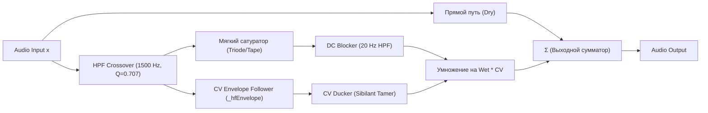
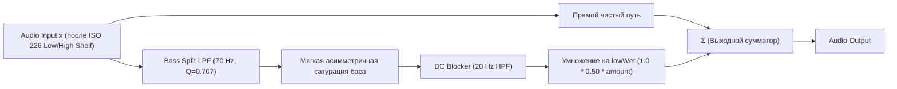

# Exciter & Harmonic Enhancement Architecture (Treble & Bass)

## 1. Обзор архитектуры (La Petite Excite / Parallel Analog Exciter)

Экситеры в FineTune Pro (как ВЧ в `EQProcessor`, так и НЧ в `LoudnessCompensator`) построены по единой образцовой схемотехнике студийного аналогового параллельного сатуратора *La Petite Excite* (Fine Cut Bodies) и принципов *Aphex Systems*.

### Ключевые параметры ВЧ-эксайтера (Treble Exciter в EQ):
- **Частота среза (Cutoff Frequency):** `1500.0 Hz`
  - *Обоснование:* При срезе 1500 Гц вторая гармоника ($2 f_0$) точно попадает в **3000 Гц** — пик резонанса слухового канала человека и певческого форманта (Singer's Formant), обеспечивая максимальную разборчивость речи и вокала. При этом полностью исключается захват носового/коробочного диапазона 1000–1400 Гц.
- **Интенсивность (Drive / Wet):** `4.0` (максимальный шелковистый воздух без клиппинга).

---

## 2. Математическая модель ВЧ-сайдчейна

### Формулы DSP ВЧ:

1. **Мягкая асимметричная сатурация (триод / аналоговая лента):**
   $$f_{\text{treble}}(u) = \begin{cases} \dfrac{u}{1.0 + 0.5 \cdot u}, & u \ge 0 \\ \dfrac{u}{1.0 - 0.15 \cdot u}, & u < 0 \end{cases}$$
   - Функция строго монотонна.
   - Производная $f'(0) = 1.0$ с обеих сторон (нулевые изломы, без скачков второй производной, без кроссоверных искажений и октавного фузза).
   - Генерирует благозвучные 2-ю (-36 dB) и 3-ю (-40 dB) гармоники, мягко компрессируя пики громких звуков.

2. **Динамический CV-даккер (сглаживание сибилянтов):**
   $$\text{Ducking} = \frac{1.0}{1.0 + \max(0, \text{envelope} - 0.20) \times 2.5}$$
   - Предотвращает перегрузку на свистящих и шипящих согласных («с», «ц», «щ»).

3. **Фазолинейный DC-блокер:**
   - Выходной фильтр настроен на **20 Гц** (HPF Q=0.707). Это полностью устраняет фазовый провал и гарантирует идеальное синфазное сложение с прямым сигналом.

4. **Масштабирование Wet Mix:**
   $$\text{effectiveWet} = \text{wetKnob} \times 0.25 \times \text{Ducking}$$
   - $0.0 \implies +0.0 \text{ dB}$ (обход)
   - $1.0 \implies +1.8 \text{ dB}$
   - $2.0 \implies +3.4 \text{ dB}$
   - $4.0 \implies +5.8 \text{ dB}$ (максимальный студийный блеск)

---

## 3. Почему попытки с вычитанием основного тона ($u - f(u)$) терпели неудачу

В процессе разработки исследовались попытки выделить «чистые гармоники» без основного тона:
1. При $u - \text{shaped} \approx u^2$:
   - Уровень гармоник падает квадратично. При реальном уровне сигнала ВЧ в -20...-30 dBFS гармоники уходят на -40...-60 dBFS и полностью маскируются музыкой (**«эффект не слышен»**).
2. При попытке компенсировать это гейном на входе ($4\times$) и выходе:
   - Создавался **16-кратный овердрайв** (THD ~15%), и экситер превращался в гитарный фузз (**«звук зудит на 1 кГц»**).
3. **Вывод:** В реальных студийных экситерах (*La Petite Excite*, *Aphex*) основной тон сайдчейна **не вычитается**, а мягко сатурируется и подмешивается целиком.

---

## 4. Разделение ролей между EQ и Loudness Compensation

| Компонент | Роль | Реализация |
|---|---|---|
| **EQ Treble Exciter** (`EQProcessor`) | Художественное обогащение звука гармониками и аналоговым «воздухом» | Полноценный сатурированный сайдчейн *La Petite Excite* (1500 Hz, Wet 4.0). |
| **Loudness Compensation** (`LoudnessCompensator`) | Коррекция кривых равной громкости (ISO 226) на малой громкости | **100% чистый линейный High-Shelf EQ** на **6000 Hz** (+3.0 dB полка по стандарту RME / ISO 226) + **Параллельный Bass Exciter** на **70 Hz** (Knob 1.5). Статично встроены в каскад тонкомпенсации без лишних ползунков в UI. Динамически масштабируются с уменьшением громкости. |

---

## 5. Архитектура Bass Exciter в Loudness Compensation

Басовый экситер в `LoudnessCompensator` построен как точный дуал студийного сатуратора *La Petite Excite*, адаптированный для низких частот:

### Фиксированные эталонные параметры:
* **Частота кроссовера:** строго фиксирована на **`70.0 Hz`** (LPF Баттерворта 2-го порядка, $Q = 0.707$).
* **Интенсивность сатурации (Knob):** строго фиксирована на **`1.0`** (эталонный студийный оптимум без утомляемости).
* **Бюджетирование Headroom (Preamp Gain):** добавка от сатуратора ($+2.92\text{ dB}$) включена в бюджет пикового гейна с коэффициентом 0.6 ($2.92 \times 0.6 = \mathbf{1.75\text{ dB}} \approx \mathbf{1.74\text{ dB}}$). При снижении громкости `_preampGain` пропорционально аттенюирует тракт на величину до **`-1.74 dB`**, исключая избыточный напор и перегрузку лимитера.
* **UI:** Все промежуточные ползунки настройки убраны из пользовательского интерфейса, обеспечивая чистый и надежный дизайн.

### Формула сатурации баса:
$$f_{\text{bass}}(u) = \begin{cases} \dfrac{u}{1.0 + 0.6 \cdot u}, & u \ge 0 \\ \dfrac{u}{1.0 - 0.2 \cdot u}, & u < 0 \end{cases}$$

### Психоакустическое обоснование параметров:
1. **Почему 70 Hz (а не 75 или 110 Hz):**
   - **Шкала Барков (Критические полосы Цвикера):** Полоса Bark 2 охватывает 100–200 Гц (панч/упругость), а Bark 3 — 200–300 Гц (муть/boxiness). При $f_c = 70$ Гц 2-я гармоника ($140$ Гц) и 3-я гармоника ($210$ Гц) ложатся строго в диапазон панча, не загрязняя нижний вокальный диапазон. При 75 Гц 3-я гармоника ($225$ Гц) пробивает границу и попадает в область мути.
   - **Нотная сетка:** Частота 70 Гц отсекает ноту Ре ($D_2 \approx 73.4$ Гц) на спаде -3.8 dB, обогащая исключительно истинный суб-бас ($C_2, B_1, A_1$, 40–65 Гц) и сохраняя прозрачность басовых риффов.
2. **Почему Knob 1.0 и учёт -1.74 dB в преампе:**
   - Значение 1.0 формирует деликатную добавку **+1.5 dB** гармоник на средней комфортной громкости и до **+2.9 dB** на тихой.
   - С компенсацией преампа на $-1.74\text{ dB}$ ($2.9\text{ dB} \times 0.6$) бас встаёт ровно в одну линию с вокалом и серединой, гарантируя абсолютный комфорт при многочасовом прослушивании без утомления слуха.
3. **Фазовая синфазность (20 Hz DC Blocker):**
   - Отсутствие второго LPF в сайдчейне исключает поворот фазы на $180^\circ$ и гарантирует чистое синфазное сложение сатурированного баса с основным сигналом.

