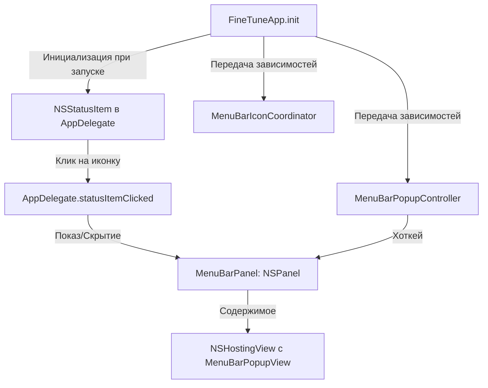

# Дизайн-документ: Удаление FluidMenuBarExtra и переход на нативный NSPanel

**Дата**: 12 июля 2026 г.
**Статус**: Утверждено

---

## Проблема

Использование сторонней библиотеки `FluidMenuBarExtra` в качестве сцены SwiftUI (`body: some Scene`) приводило к нестабильному жизненному циклу элементов меню-бара. При определенных действиях пользователя и перестроении SwiftUI-сцен объект состояния `StateObject` внутри сцены деаллоцировался, что делало иконку приложения неактивной («некликабельной»), либо порождало дублирующие элементы («призраки») в системном меню-баре.

Попытки отслеживать клики через глобальные мониторы событий (`NSEvent.addGlobalMonitorForEvents`) вызывали ложные срабатывания при нажатии на соседние системные иконки и требовали использования сложных хаков с рефлексией (Mirror) для предотвращения деаллокации.

---

## Решение

Мы полностью удаляем стороннюю библиотеку `FluidMenuBarExtra` и заменяем её нативным AppKit-компонентом `MenuBarPanel` (наследник `NSPanel`) с постоянным жизненным циклом, управляемым один раз при запуске приложения. 

Это устраняет необходимость в рефлексии, обходных путях `KeepAlive` и сканировании окон `NSApp.windows`.

---

## Архитектурные изменения

### 1. Точка входа и жизненный цикл (`FineTuneApp.swift`)
* В `FineTuneApp` удаляется сцена `FluidMenuBarExtra`. В `body` остается только сцена `Settings`.
* Инициализация статус-айтема (`NSStatusItem`) переносится в конструктор `FineTuneApp.init()` с отсрочкой через `DispatchQueue.main.async`.
* Ссылка на созданный статус-айтем сохраняется в `AppDelegate`.

### 2. Кастомная панель меню-бара (`MenuBarPanel.swift`) [Новый файл]
Мы создаем класс `MenuBarPanel: NSPanel`, который:
* Имеет стиль `.borderless` и уровень `.statusBar` для нативного перекрытия окон.
* Имеет поведение `.canJoinAllSpaces` для работы на любом рабочем столе.
* Включает `NSVisualEffectView` с материалом `.popover` (для эффекта Liquid Glass).
* Хостит SwiftUI-представление `MenuBarPopupView` внутри `NSHostingView`.
* Автоматически позиционирует себя под иконкой кликнутого монитора, учитывая края экрана.
* Закрывается при потере фокуса или клике вне окна через глобальный монитор событий.

### 3. Упрощение координации (`MenuBarIconCoordinator.swift` & `MenuBarPopupController.swift`)
* `MenuBarIconCoordinator` получает кнопку статус-айтема напрямую из `AppDelegate`. Метод `resolveButton()` сокращается до одной строки.
* `MenuBarPopupController` переключает видимость `MenuBarPanel` напрямую, без имитации кликов мыши.

---

## План тестирования

1. **Сборка проекта**: Убедиться, что проект компилируется без предупреждений о несовместимости с Swift 6 Concurrency.
2. **Интерфейс**: Проверить наведение, клики и появление панели под иконкой.
3. **Многомониторность**: Проверить клики на основном и дополнительном мониторах (панель должна всплывать ровно под иконкой на том мониторе, где был совершен клик).
4. **Пространства (Spaces)**: Убедиться, что при переключении Spaces окно отображается корректно и не перекидывает пользователя на другой рабочий стол.
5. **Юнит-тесты**: Убедиться, что все тесты проходят успешно.
