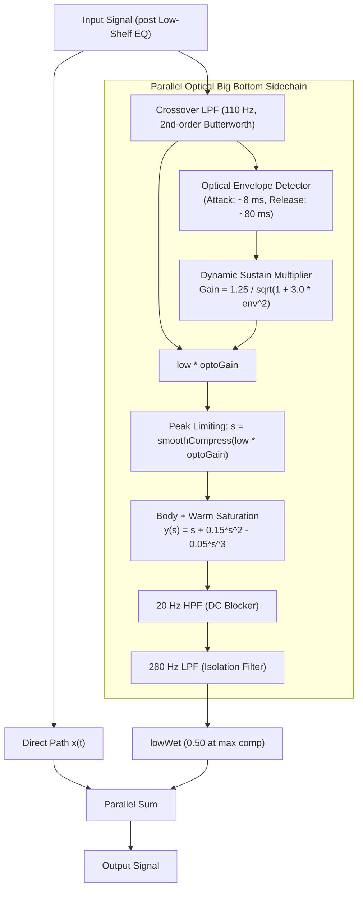

# Aphex Optical Big Bottom DSP Design

**Date:** 2026-10-31  
**Status:** Approved  
**Author:** FineTune DSP Engineering  

---

## 1. Problem Statement & Philosophy

Traditional loudness compensation and bass enhancers often face a fundamental trade-off:
- **Missing Fundamental Enhancers (e.g. Waves MaxxBass):** Isolate the low band, synthesize upper harmonics ($2f_0, 3f_0$), and frequently attenuate or filter the original infrabass fundamental to protect small speaker cones. While audible on laptop speakers, this removes the physical punch, club body, and tactile weight from high-fidelity listening systems and headphones.
- **Static Equalization (+10 dB Low Shelf):** Boosting the sub-bass with static filters introduces massive peak excursions on kick drums, consuming headroom and leading to harsh digital clipping or limiter pumping at medium listening levels (e.g. 25–35% volume).

**Aphex Optical Big Bottom Philosophy:**
*"Make the bass massive, fat, vibrating, and sustained like in a club, while keeping peak excursion strictly under control."*
1. Takes the entire low band ($\le 110$ Hz).
2. **Never** cuts the fundamental sub-bass frequencies ($30–100$ Hz).
3. Processes the band through an optical-style compressor/limiter: tames kick drum transient spikes, but dramatically swells the sustain (body/tail) of the bass.
4. Enriches this compressed signal with warm, analog-style soft saturation.
5. Injects this dense, pumped bass in parallel with the direct signal.

---

## 2. DSP Signal Flow & Topology

---

## 3. Mathematical Specifications

### 3.1 Crossover Filter
- **Type:** 2nd-order Butterworth Low-Pass Filter ($Q = 0.707$).
- **Cutoff:** $f_c = 110.0$ Hz.
- Extracts `lowL` and `lowR` without ringing or ripple.

### 3.2 Optical Envelope Follower
- **Peak Detector:** $x_{\text{instant}} = \max(|low_L|, |low_R|)$.
- **Ballistics:**
  - **Attack ($\approx 8$ ms):** Quick transient detection to catch kick drum strikes:
    $$env[n] = 0.997 \cdot env[n-1] + 0.003 \cdot x_{\text{instant}}[n] \quad (x_{\text{instant}} > env)$$
  - **Release ($\approx 80$ ms):** Smooth optical decay to hold and expand bass sustain:
    $$env[n] = 0.9997 \cdot env[n-1] \quad (x_{\text{instant}} \le env)$$

### 3.3 Dynamic Optical Sustain Gain
$$G_{\text{opto}}(env) = \frac{1.25}{\sqrt{1.0 + 3.0 \cdot env^2}}$$
- **Sustain Expansion ($env \to 0$):** $G_{\text{opto}} = 1.25$ ($+1.94$ dB). Low-level decaying bass tails are boosted.
- **Transient Taming ($env = 1.0$):** $G_{\text{opto}} = 0.625$ ($-4.08$ dB). Loud kick strikes are attenuated, freeing dynamic headroom.

### 3.4 Instantaneous Soft Peak Limiter
$$s = \text{smoothCompress}(low \cdot G_{\text{opto}}) = \frac{x}{\sqrt{1.0 + x^2}}$$
- Assures $|s| < 1.0$ unconditionally, preventing hard digital clipping before the non-linear transfer stage.

### 3.5 Soft Saturation & Fundamental Retention
$$y(s) = s + 0.15 s^2 - 0.05 s^3$$
- **Linear fundamental ($s$):** Directly carries the optically leveled fundamental sub-bass.
- **Even harmonic ($+0.15 s^2$):** Synthesizes warm 2nd harmonic overtone ($2f_0$), adding fullness and small-speaker audibility.
- **Odd limiting ($-0.05 s^3$):** Softly bounds maximum excursions without high-order harmonic splatter.
- **Peak bounded:** For $|s| \le 0.9$, $|y(s)| \le 0.985$.

### 3.6 Post-Processing Filters
1. **DC Blocker (`_lowPostHPF`):** 20 Hz 2nd-order Butterworth HPF.
   - Eliminates the DC bias ($\frac{1}{2} \cdot 0.15 \cdot A^2$) produced by the $s^2$ term.
   - At $40$ Hz, insertion loss is $< 0.3$ dB (transparent to musical bass).
2. **Isolation LPF (`_lowPostLPF`):** 280 Hz 2nd-order Butterworth LPF.
   - Attenuates any upper harmonics above 280 Hz, isolating energy strictly to the bass register.

### 3.7 Headroom Calibration
Coherent peak budget for low band:
$$\text{bassPeakDB} = \text{shelfPeakDB} + 20 \log_{10}(1.0 + lowWet \times 1.10)$$
At maximum compensation ($lowWet = 0.50$):
$$\text{bassPeakDB} = 10.0 + 20 \log_{10}(1.55) \approx 13.8\text{ dB}$$
The global digital preamp applies attenuation whenever available digital headroom is less than $\text{bassPeakDB}$:
$$\text{preampGain} = 10^{-\max(0, \text{peakDB} - \text{availableDB}) / 20}$$
This guarantees $0$ dBFS ceiling compliance across all system volume settings.

---

## 4. Verification & Testing Criteria

1. **Fundamental Retention:** Verify that the sidechain output contains strong energy at $f_0 = 50$ Hz when driven by a 50 Hz sine wave.
2. **Harmonic Generation:** Verify presence of 2nd harmonic ($100$ Hz) and bounded 3rd harmonic ($150$ Hz).
3. **Transient Boundedness:** Verify that high-amplitude kick-like pulses do not exceed unity output peak ratio after parallel combination and preamp attenuation.
4. **DC Elimination:** Verify that mean DC offset after `_lowPostHPF` remains below $10^{-4}$.
5. **Full Unit Test Suite:** Run `FineTuneTests` via `xcodebuild test` and ensure 0 failures.
6. **Binary Release Build:** Archive and codesign `FineTune.app`.

